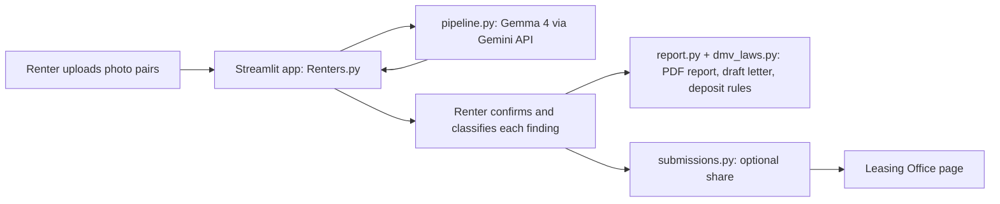

# Move-In / Move-Out Photo Evidence Tool

**GDG Build with AI x Hacktoberfest 2026 | AI for Housing | Virginia Tech**

> Documentation, not legal advice. The AI suggests, the human decides.

**Try it live: https://lease-no-trace.streamlit.app/**
No account and no API key needed.

## For judges: how to try it in 2 minutes

1. Open the live link. Click **Load the saved example** to see a real AI result without uploading anything, or upload your own before/after photos and click **Run Analysis**.
2. Check a finding, choose how you see it (normal wear, already there at move-in, or damage you accept responsibility for), add a note, then click **Generate PDF Report & Draft Letter** and download it.
3. Open **Leasing Office** in the menu and click **Preview with sample data** to see what a leasing office sees. No password is needed, and the preview uses made-up data only. Real submissions from renters need the leasing office password.

## The problem

Residents in the DMV (D.C., Maryland, and Virginia) regularly run into unexpected move-out fees and conflicting claims about damage that may have been there from the start. Online reviews of local leasing offices describe these patterns. Renters rarely have organized, timestamped evidence to push back with, and leasing offices have no fair, shared record to point to either.

## What it does

1. A renter uploads matched **move-in (before)** and **move-out (after)** photos of a room, up to 5 pairs.
2. **Gemma 4** (through the Gemini API) flags *possible* differences in each pair.
3. The renter **reviews every finding**: confirms it, says how they see it, and adds a note. Only confirmed items are used.
4. The app produces a **PDF evidence report** (side-by-side photos, the date each photo was taken, SHA-256 file hashes, the renter's notes, the deposit rules for the chosen jurisdiction) and a **draft security-deposit letter** built from the renter's own choices.
5. Optionally, the renter can **share** the confirmed items with the leasing office, who can open a renter's entry and see the photos, upload date, and issues on a separate password-protected page.

**Guiding principles:** the AI suggests, the human decides. Only renter-confirmed items go in the report. The AI never decides what is chargeable.

## Model

| | |
|---|---|
| Model used by the live demo and the saved example | **`gemma-4-26b-a4b-it`** (Gemma 4) through the Gemini API (`google-genai` Python package) |
| Larger option | `gemma-4-31b-it`. Set `GEMMA_MODEL` to switch. It is the code's default if nothing is set. |
| Where it is called | `pipeline.py`, function `compare_photos` |
| Gemma license | https://ai.google.dev/gemma/terms |

The model name is shown in the app's sidebar. Gemma does the core comparison itself. No other model is used for that step. The "AI Sensitivity" slider changes the instructions sent to the model: low reports only clear problems, high also reports small marks.

## Quick start (under 10 minutes)

```bash
git clone https://github.com/narxalotl/GDG-Hackathon
cd GDG-Hackathon
python -m venv venv
source venv/bin/activate        # Windows: venv\Scripts\activate
pip install -r requirements.txt
```

1. Get a free API key from [Google AI Studio](https://aistudio.google.com).
2. Create a file named `.env` in the project root:

```
GEMINI_API_KEY=your_key_here
GEMMA_MODEL=gemma-4-26b-a4b-it
LEASING_PASSWORD=choose_a_password
```

3. Run the app:

```bash
streamlit run Renters.py
```

`.env` is gitignored and must never be committed. No key? Click **Load the saved example** (no AI call), or set `USE_FAKE=1` in `.env` for a test mode with fake results. Visitors to a hosted copy can also paste their own free key in the sidebar under **AI access**.

## How it works



| File | What it does |
|---|---|
| `Renters.py` | Streamlit interface: upload, review, confirm, download, share |
| `pages/Leasing_Office.py` | Leasing office page: password for real submissions, sample preview for everyone |
| `pipeline.py` | Calls Gemma 4, cleans and validates the JSON, retries on busy errors, caches results |
| `report.py` | Builds the PDF: photos, photo dates, SHA-256 hashes, notes, draft letter |
| `dmv_laws.py` | Deposit-law summaries for Virginia, Maryland, and D.C., with official links |
| `submissions.py` | Saves renter-approved submissions for the leasing office |
| `demo/` | Saved example: photos and a real model result |
| `data/` | Test photos (GPS location data removed) |
| `.streamlit/config.toml` | Dark theme, so the page looks the same on every computer |
| `check_photos.py`, `make_demo.py`, `scrub_history.py` | Helpers: check photo dates and location data, build the saved example, remove photos with location data from git history |

## Evaluation

We tested the tool on 4 before/after photo pairs (see `data/`). We did **not** run a formal benchmark, so we do not report accuracy percentages.

One result you can inspect yourself is saved in `demo/`: on the bathtub pair, `gemma-4-26b-a4b-it` flagged two stains (the bottom of the tub, and the wall below the spout) with high confidence. Both are visible in the move-out photo.

A larger labeled test (counting real changes caught, missed, and false alarms, including lighting and shadow traps) is future work.

## Responsible AI

**Safety and grounding**
- Every AI result is labeled a *possible* difference. Only items the renter confirms are used, and the renter chooses how each one is classified.
- The prompt tells the model to ignore lighting, shadows, and moved items, to report only what it can clearly see, and to say "low confidence" when unsure.
- The deposit rules in the report and letter are short summaries written by our team from the official sources linked in `dmv_laws.py` (Virginia Code § 55.1-1226, Maryland Real Property § 8-203, D.C. Code § 42-3502.17). The model does not write legal claims.
- A visible banner and every report state that the tool is not legal advice.

**Privacy**
- Photos are sent to Google's Gemini API for analysis. The app says so before upload.
- No accounts. Name and unit are collected only if a renter chooses **Send to leasing office**, which needs a consent checkbox.
- Photos are processed in a temporary per-session folder (cleared on Reset or when the server restarts). They are kept on the server only if the renter shares them with the leasing office.
- The leasing office page needs a password. The sample preview uses made-up data, never a real renter's.
- The sample photos in `data/` and `demo/` had their GPS location data removed. Photo dates are kept.

**Accessibility:** labeled inputs, keyboard-friendly controls, text captions on images, plain-language wording, and status shown with text and not color alone.

**Equity:** photo quality depends on the phone someone owns. The app includes tips for taking good comparison photos.

## Known limitations

- Poor lighting, mismatched angles, and small or subtle damage are often missed.
- The model can flag harmless differences. This is why the renter confirms every item.
- The leasing office page uses a shared password, and renters are identified by the name and unit they type. Real logins are future work.
- Shared submissions are stored on the server's disk. Hosting that resets its disk (for example Streamlit Community Cloud) would lose them. A database or storage bucket is future work.
- The hosted app depends on one shared API key and free-tier rate limits. Each session gets a limited number of analyses on that key, and visitors can use their own key instead.

## Cost and deployment

- Runs on a laptop with a free API key and one command.
- Inference cost: free tier. `gemma-4-26b-a4b-it` is the cheaper, faster option.
- Hosted on Streamlit Community Cloud. The key lives in the platform's **Secrets**, never in the repo, so visitors never need their own key:

```
GEMINI_API_KEY = "your_key"
GEMMA_MODEL = "gemma-4-26b-a4b-it"
LEASING_PASSWORD = "choose_a_password"
```

- A nonprofit or student organization could host the same way with a free key.

## Future work

- Local "private mode" using Ollama and a small Gemma 4 model, so photos never leave the device
- Real renter and leasing-office accounts, with a database for shared submissions
- A labeled evaluation set, with caught, missed, and false-alarm counts
- Other college towns, then general rentals (landlords benefit from fair, documented inspections too)
- Landlord-side inspection workflow

## Problem validation

We have not yet interviewed residents. These are illustrative personas, based on the patterns we saw in public reviews of local leasing offices, not real people:

- **Maya, a student renter.** She shares a four-bedroom apartment, moved in without a checklist, and worries about being charged for damage she did not cause. She needs dated photos and a way to say what was already there.
- **Mr. Alvarez, a small leasing coordinator.** He gets conflicting claims at every move-out and wants one shared, timestamped record instead of arguments.
- **Dev, a young professional moving between D.C. and Maryland.** The deposit rules differ by place, so he needs a plain-language summary and the deadline for where he is renting.

Next step: ask residents about their own experiences, since housing experiences differ across the DMV.

## Dependencies

`streamlit`, `google-genai`, `pillow`, `python-dotenv`, `reportlab` (see `requirements.txt`).

## Team

- Person 1: Maryam Jadoon
- Person 2: Samina Mouhamad
- Person 3: Trisha Cherian

## License

MIT. See `LICENSE`.
