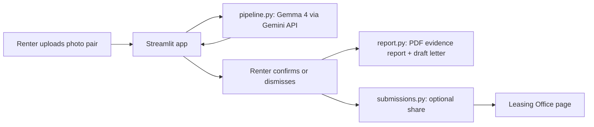

# GDG-Hackathon
GDG Hackathon Repo

# Move-In / Move-Out Photo Evidence Tool

**GDG Build with AI x Hacktoberfest 2026 | AI for Housing | Virginia Tech**

> Documentation, not legal advice. The AI suggests, the human decides.

## The problem

Students in Blacksburg regularly run into unexpected move-out fees and conflicting claims about
damage that may have been there from the start. Online reviews of local leasing offices describe
these patterns. Tenants rarely have organized, timestamped evidence to push back with, and
leasing offices have no fair, shared record to point to either.

## What it does

1. A renter uploads a matched **before (move-in)** and **after (move-out)** photo of a room.
2. **Gemma 4** (through the Gemini API) flags *possible* differences.
3. The renter **confirms or dismisses** each one and adds a note. Only confirmed items are used.
4. The app produces a **PDF evidence report** (side-by-side photos, photo timestamps, SHA-256 file
   hashes) and a **draft security-deposit letter** citing the relevant Virginia rules.
5. Optionally, the renter can **share** the confirmed items with the leasing office, who can open a
   renter's account and see the photos, upload date, and issues on a separate password-protected page.

**Guiding principles:** the AI suggests, the human decides. Only tenant-confirmed items go in the
report. Small and working beats large and unfinished.

## Model

| | |
|---|---|
| Model | `gemma-4-31b-it` via the Gemini API (`google-genai` Python package) |
| Alternative tested | `gemma-4-26b-a4b-it` |
| Where it is called | `pipeline.py`, function `compare_photos` |
| Gemma license | https://ai.google.dev/gemma/terms |

Gemma does the core comparison itself. No other model is used for that step.

## Quick start (under 10 minutes)

```bash
git clone https://github.com/narxalotl/GDG-Hackathon
cd GDG-Hackathon
python -m venv venv
source venv/bin/activate        # Windows: venv\Scripts\activate
pip install -r requirements.txt
```

1. Get a free API key from [Google AI Studio](https://aistudio.google.com).
2. Create a file named `.env` in the project root:

```
GEMINI_API_KEY=your_key_here
LEASING_PASSWORD=choose_a_password
```

3. Run the app:

```bash
streamlit run app.py
```

`.env` is gitignored and must never be committed. No key? Use the **Load the saved example**
button, which makes no AI call.

## How it works



| File | What it does |
|---|---|
| `app.py` | Streamlit interface: upload, review, confirm/dismiss, download |
| `pipeline.py` | Calls Gemma 4, parses and validates the JSON, caches results |
| `report.py` | Builds the PDF: photos, timestamps, SHA-256 hashes, letter |
| `submissions.py` | Saves renter-approved submissions for the leasing office |
| `pages/Leasing_Office.py` | Password-protected page: pick a renter, see photos, dates, issues |
| `data/` | Staged test photos, `labels.csv`, `va_deposit_rules.txt` |

## Evaluation

We staged photo pairs where we know exactly what changed: real changes, false-alarm traps
(lighting, shadows, moved items), and no-change pairs.

| Model | Pairs tested | Real changes caught | Missed | False alarms | Avg seconds per pair |
|---|---|---|---|---|---|
| gemma-4-31b-it | [N] | [N] | [N] | [N] | [N] |
| gemma-4-26b-a4b-it | [N] | [N] | [N] | [N] | [N] |

[ONE SENTENCE ON WHAT YOU LEARNED, INCLUDING WHERE THE MODEL FAILED.]

Time to produce a report: about less than 1 minute from upload to PDF.

## Responsible AI

**Safety and grounding**
- Every AI result is labeled a *possible* difference. Only items the renter confirms are used.
- The prompt tells the model to ignore lighting, shadows, and moved items, and to say "low
  confidence" when unsure.
- Legal text in the letter comes from Virginia statute text our team copied and checked
  (https://law.lis.virginia.gov/vacode/title55.1/chapter12/section55.1-1226/, saved in `dmv_laws`). The model does not write legal claims.
- A visible banner states the tool is not legal advice.

**Privacy**
- Photos are sent to Google's Gemini API for analysis. The app says so before upload.
- No accounts and no personal details beyond what the renter types into the letter.
- Photos are processed in a per-session temporary folder. They are kept on the server **only if**
  the renter chooses **Send to leasing office**, with a consent checkbox.
- GPS location data is stripped from every photo committed to this repo. Photo timestamps are kept.

**Accessibility:** labeled inputs, keyboard-only use, text captions on images, plain-language
wording, status shown with text and not color alone.

**Equity:** photo quality depends on the phone someone owns. The app includes tips for taking good
comparison photos.

## Known limitations

- Poor lighting, mismatched angles, and small or subtle damage are often missed.
- The model can flag harmless differences. This is why the renter confirms every item.
- The leasing office page uses a shared password, and renters are identified by the name and unit
  they type. Real logins are future work.
- Shared submissions are stored on local disk. Hosting that resets its disk (for example Streamlit
  Community Cloud) would lose them. A database or storage bucket is future work.
- The app depends on one shared API key and free-tier rate limits.

## Cost and deployment

- Runs on a laptop with a free API key and one command.
- Inference cost: free tier; `gemma-4-26b-a4b-it` is the cheaper, faster option.
- For public hosting, store the key as a platform secret (for example Streamlit Community Cloud
  Secrets) so users never need their own key. The app limits live analyses per session.
- A nonprofit or student org could host it with one command and a free key.

## Future work

- Local "private mode" using Ollama and a small Gemma 4 model, so photos never leave the device
- Real renter and leasing-office accounts, with a database for shared submissions
- Other college towns, then general rentals (landlords benefit from fair, documented inspections too)
- Landlord-side inspection workflow

## Problem validation

We can ask residents in the future about their specific personal experiences, as many residents have different experiences with DMV housing.

## Dependencies

`streamlit`, `google-genai`, `pillow`, `python-dotenv`, `reportlab` (see `requirements.txt`).

## Team

- Person 1: Maryam Jadoon
- Person 2: Samina Mouhamad
- Person 3: Trisha Cherian

## License

Apache-2.0. See `LICENSE`.